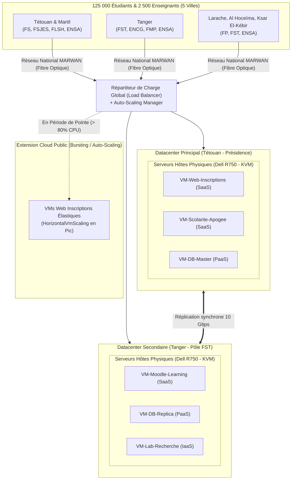

# Étape 1 : Documentation sur l'Université Abdelmalek Essaâdi (UAE) et Architecture Cloud Cible

## 1. Contexte et Données Réelles de l'UAE

L'Université Abdelmalek Essaâdi (UAE), fondée en 1989 et ayant son siège à Tétouan, est la grande université publique de la région Tanger-Tétouan-Al Hoceïma.

### A. Implantation géographique et Établissements (Sources : [CERN](https://indico.cern.ch/event/1244727/), [Wikipédia](https://en.wikipedia.org/wiki/Abdelmalek_Essa%C3%A2di_University), [LaVérité.ma](https://www.laverite.ma/luniversite-abdelmalek-essaadi-lance-83-nouvelles-filieres-de-formation-couvrant-les-differentes-specialites/))
* **5 villes principales** : Tétouan (avec Martil), Tanger, Larache, Al Hoceïma, Ksar El-Kébir.
* **16 établissements d'enseignement supérieur** :
  * **Tétouan / Martil** : Faculté des Sciences (FS), Faculté Polydisciplinaire (FP), FSJES, FLSH, ENSA, ENS.
  * **Tanger** : FST, FSJES, Faculté de Médecine et Pharmacie (FMP), ENCG, ENSA, ESRFT.
  * **Al Hoceïma** : FST, ENSA.
  * **Larache et Ksar El-Kébir** : Faculté Polydisciplinaire (FP).

### B. Population universitaire (Source : Communiqué officiel Rentrée UAE 2022-2023, [Aujourd'hui le Maroc](https://aujourdhui.ma/?p=382140))
* **Nombre total d'étudiants** : ~125 000 étudiants inscrits (222 formations initiales, 74 formations continues).
* **Nouveaux inscrits par an** : ~27 000 nouveaux bacheliers (générateurs du pic annuel de charge).
* **Corps enseignant** : Environ 2 500 enseignants-chercheurs (estimation réaliste basée sur la moyenne nationale marocaine et un ratio de ~1 enseignant pour 50 étudiants).
* **Personnel administratif et technique** : Environ 800 agents répartis sur les 16 établissements.

### C. Services numériques recensés
1. **SaaS Institutionnel** :
   * Portail unifié de préinscription en ligne (`pre-inscription.uae.ac.ma`).
   * Plateforme d'apprentissage en ligne (Moodle / e-VAL).
   * Messagerie académique (Google Workspace / Microsoft 365 Éducation).
   * Plateforme de gestion de scolarité (Apogée / notes, emplois du temps).
   * Bibliothèque et ressources documentaires numériques.
2. **IaaS / PaaS Recherche et Pédagogie** :
   * Machines virtuelles pour les laboratoires et projets d'ingénierie (ENSA, FST).
   * Base de données centrale PostgreSQL / MySQL clusterisée.

---

## 2. Architecture Cloud Proposée

Pour répondre aux contraintes géographiques et garantir une haute disponibilité, nous proposons une architecture à **deux datacenters interconnectés par fibre optique (Réseau MARWAN)**.

### A. Emplacement et Rôle des Datacenters
* **Datacenter Principal (DC-1 - Tétouan / Présidence)** :
  * Héberge les services centraux critiques : portail de scolarité, base de données unifiée, inscriptions.
  * Capacité : 6 serveurs physiques hôtes (Hosts) haute performance.
* **Datacenter Secondaire / Secours (DC-2 - Tanger / Pôle Technologique FST/ENSA)** :
  * Assure la réplication en temps réel (Disaster Recovery), héberge les plateformes e-learning et les laboratoires de recherche.
  * Capacité : 4 serveurs physiques hôtes.

### B. Spécifications matérielles des Serveurs Hôtes (Hosts)
Chaque serveur physique (Host type Dell PowerEdge R750) dispose de :
* **Processeurs** : 2 x 16 cœurs (32 cœurs / 64 threads vCPU à 2.8 GHz $\approx$ 180 000 MIPS cumulés).
* **Mémoire RAM** : 128 Go à 256 Go ECC.
* **Stockage** : SAN / Ceph haute vitesse (NVMe/SSD).
* **Bande passante réseau** : 10 Gbps redondé.

### C. Répartition des Machines Virtuelles (VM) par Service

| Service | Modèle Cloud | Rôle | vCPU | RAM | Stockage |
| :--- | :---: | :--- | :---: | :---: | :---: |
| **VM-Web-Inscriptions** | SaaS | Serveur Web Frontend (Nginx/PHP) pour `pre-inscription` | 4 vCPU | 8 Go | 40 Go |
| **VM-Moodle-Learning** | SaaS | Plateforme e-learning (cours, devoirs, vidéos) | 4 vCPU | 16 Go | 100 Go |
| **VM-Scolarite-Apogee** | SaaS | Gestion des étudiants, notes, attestations | 4 vCPU | 8 Go | 50 Go |
| **VM-DB-Cluster** | PaaS | Base de données relationnelle centrale (Master/Replica) | 8 vCPU | 32 Go | 200 Go |
| **VM-Lab-Recherche** | IaaS | Environnements de simulation et TP étudiants (FST/ENSA) | 4 vCPU | 8 Go | 50 Go |

### D. Modèle de Déploiement : Cloud Hybride
* **Cloud Privé interne (Datacenters UAE)** : Pour les données sensibles (notes, scolarité, identités des étudiants).
* **Cloud Public (Bursting / Débordement)** : En période de rentrée, activation de l'élasticité horizontale (**HorizontalVmScaling**) pour absorber l'afflux des 27 000 nouveaux bacheliers sans saturer l'infrastructure locale.

---

## 3. Schéma Global de l'Architecture Cloud UAE

