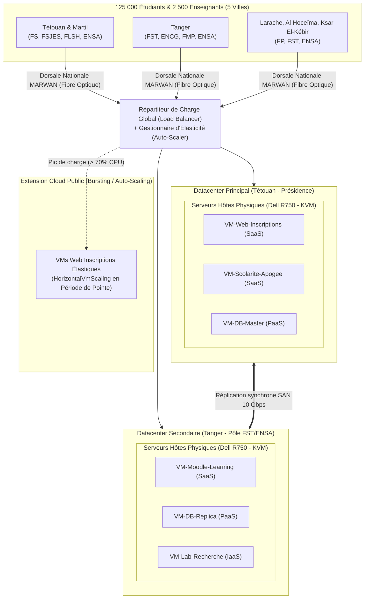

# Rapport de Projet Cloud Computing — Partie 1 : Simulation d'un Cloud Universitaire avec CloudSim Plus

**Auteur :** Yahya Ahmane  
**Date :** 07 Novembre 2026  
**Établissement cible :** Université Abdelmalek Essaâdi (UAE)  
**Technologies :** Java 21, Apache Maven, Framework CloudSim Plus (v8.0.0)  
**Projet :** Cloud Intelligence — Encadré par le Prof. C. EL AMRANI  

---

## 1. Documentation sur l'Université Abdelmalek Essaâdi (UAE)

L'Université Abdelmalek Essaâdi (UAE), fondée en 1989 et dont le siège est situé à Tétouan, est la principale université publique de la région administrative Tanger-Tétouan-Al Hoceïma.

### A. Répartition géographique et établissements
L'université est implantée dans **5 villes principales** et compte **16 établissements d'enseignement supérieur** (10 facultés et 6 grandes écoles) :
* **Tétouan et Martil** : Faculté des Sciences (FS), Faculté des Lettres et des Sciences Humaines (FLSH), Faculté des Sciences Juridiques, Économiques et Sociales (FSJES), Faculté Polydisciplinaire (FP), École Nationale des Sciences Appliquées (ENSA), École Normale Supérieure (ENS).
* **Tanger** : Faculté des Sciences et Techniques (FST), FSJES, Faculté de Médecine et de Pharmacie (FMP), École Nationale de Commerce et de Gestion (ENCG), ENSA, École Supérieure Roi Fahd de Traduction (ESRFT).
* **Al Hoceïma** : Faculté des Sciences et Techniques (FST), ENSA.
* **Larache et Ksar El-Kébir** : Faculté Polydisciplinaire (FP).

*(Sources : [Wikipédia UAE](https://en.wikipedia.org/wiki/Abdelmalek_Essa%C3%A2di_University), [Conférence CERN / UAE](https://indico.cern.ch/event/1244727/), [LaVérité.ma - Filières de formation UAE](https://www.laverite.ma/luniversite-abdelmalek-essaadi-lance-83-nouvelles-filieres-de-formation-couvrant-les-differentes-specialites/)).*

### B. Population universitaire et charges réelles
* **Nombre total d'étudiants** : Environ **125 000 étudiants** (222 formations initiales et 74 formations continues).
* **Flux annuel de nouveaux inscrits** : Environ **27 000 nouveaux bacheliers par an**. Ce flux massif et concentré sur quelques jours est le générateur principal du pic critique de charge sur l'infrastructure.
* **Corps enseignant** : En l'absence de publication officielle consolidée propre à l'UAE, nous posons l'hypothèse documentée suivante : avec 16 établissements et une moyenne de ~150 enseignants par établissement, le corps professoral est estimé à environ **2 500 enseignants-chercheurs**, soit un ratio d'encadrement pédagogique d'environ 1 enseignant pour 50 étudiants (cohérent avec les 15 325 enseignants à l'échelle nationale).
* **Personnel administratif et technique** : Environ **800 agents**.

*(Sources : [Communiqué de presse officiel UAE Rentrée Universitaire](https://www.uae.ma/website/sites/default/files/COMMUNIQUE%20DE%20PRESSE%20RENTREE%20UNIVERSITAIRE%20VF%282%29.pdf), [Aujourd'hui le Maroc](https://aujourdhui.ma/?p=382140), [Rapport RH ENSA Tétouan](https://ensa-tetouan.ac.ma/wp-content/uploads/2024/07/ENSA-TETOUAN-3.pdf)).*

### C. Services numériques recensés
1. **Services existants confirmés** :
   * Portail de préinscription en ligne des bacheliers (`pre-inscription.uae.ac.ma`).
   * Plateforme numérique intelligente unifiée (déployée dans le cadre du plan PACTE ESRI pour les établissements à accès ouvert).
   * Plateformes e-learning Moodle et projets d'enseignement hybride (Projet européen Erasmus+ e-VAL coordonné avec l'Université de Cadix, congrès ELUT).
2. **Services institutionnels usuels** :
   * Système de gestion de scolarité (gestion des notes Apogée, attestations, emplois du temps).
   * Messagerie académique institutionnelle pour les étudiants et enseignants.
   * Bibliothèque universitaire et portails documentaires numériques.
   * Environnements de calcul scientifique et machines virtuelles pour les TP d'ingénierie (ENSA, FST).

---

## 2. Architecture Cloud Proposée

Pour garantir la haute disponibilité et la souveraineté des données académiques réparties sur les 5 villes, nous proposons une architecture de **Cloud Hybride** articulée autour de **deux datacenters régionaux** interconnectés par le réseau national de recherche MARWAN (liaison fibre optique redondée 10 Gbps).

### A. Emplacement et rôle des Datacenters
1. **Datacenter Principal (DC-1 — Tétouan / Présidence)** :
   * Héberge les bases de données centrales (Master), le portail de scolarité, la messagerie et les services administratifs.
   * Dimensionnement : **6 serveurs hôtes physiques** multi-cœurs.
2. **Datacenter Secondaire / Backup (DC-2 — Tanger / Pôle Technologique FST/ENSA)** :
   * Assure le plan de reprise d'activité (Disaster Recovery), la réplication en temps réel des bases de données et l'hébergement des clusters e-learning et TP de recherche.
   * Dimensionnement : **4 serveurs hôtes physiques**.

### B. Caractéristiques des Serveurs Hôtes (Hosts)
Chaque serveur physique (type Dell PowerEdge R750 virtualisé sous KVM) possède :
* **Processeurs** : 2 CPU de 16 cœurs (soit 32 cœurs logiques à $10\,000\text{ MIPS}$ par cœur $\approx 320\,000\text{ MIPS}$ par serveur).
* **Mémoire RAM** : 256 Go de RAM ECC.
* **Bande passante** : 10 Gbps.
* **Stockage** : 2 To NVMe / SAN Ceph redondé.

### C. Répartition des Machines Virtuelles par Service et Modèle Cloud

| Service | Modèle Cloud | Rôle | vCPU | RAM | Stockage |
| :--- | :---: | :--- | :---: | :---: | :---: |
| **VM-Web-Inscriptions** | **SaaS** | Serveur Web Frontend (Nginx/PHP) pour les inscriptions | 4 | 16 Go | 50 Go |
| **VM-Moodle-Learning** | **SaaS** | Plateforme e-learning (cours, supports multimédias) | 4 | 16 Go | 100 Go |
| **VM-Scolarite-Apogee** | **SaaS** | Gestion administrative (notes, diplômes, dossiers) | 4 | 16 Go | 50 Go |
| **VM-DB-Cluster** | **PaaS** | SGBD relationnel unifié (PostgreSQL Master/Replica) | 8 | 32 Go | 200 Go |
| **VM-Lab-Recherche** | **IaaS** | Instances de calcul à la demande pour laboratoires (FST/ENSA) | 4 | 16 Go | 50 Go |

### D. Justification du Modèle de Déploiement : Cloud Hybride
* **Cloud Privé interne (Datacenters UAE)** : Héberge en permanence les données sensibles, confidentielles et souveraines (fichiers étudiants, notes, diplômes).
* **Extension Cloud Public (Cloud Bursting)** : Lors du pic des inscriptions (27 000 bacheliers), l'université utilise l'élasticité horizontale (**HorizontalVmScaling**) pour instancier des répliques frontales temporaires et éviter tout effondrement de l'infrastructure locale.

### E. Schéma de l'Architecture Cloud Universitaire



---

## 3. Modélisation des Charges (Normale vs Pointe)

La charge de requêtes soumise au système a été modélisée sous forme de **Cloudlets** caractérisés par leur taille en millions d'instructions (MI) :

1. **Période Normale (Activités quotidiennes)** :
   * Consultation courante des cours sur Moodle, téléchargement de polycopiés, messagerie.
   * Requêtes légères et étalées : **$10\,000\text{ MI}$ par Cloudlet**.
   * Volume de simulation : **200 Cloudlets**.
2. **Période de Pointe (Rentrée / 27 000 nouveaux bacheliers)** :
   * Afflux massif sur le portail `pre-inscription.uae.ac.ma` (téléversement de documents scannés, formulaires de filières, écritures concurrentes en base de données).
   * Requêtes lourdes : **$20\,000\text{ MI}$ par Cloudlet** ($\times 2$).
   * Volume de simulation : **800 Cloudlets** ($\times 4$ de volume brut, soit une charge cumulée $\times 8$).

---

## 4. Simulation dans CloudSim Plus et Comparaison des Politiques

Le code Java développé respecte une architecture modulaire stricte (**Single Responsibility Principle**) sous le package `org.uae.cloudsim` :
* `SimulationConfig.java` : Dimensionnement matériel et paramètres de charge.
* `DatacenterFactory.java` : Instanciation des hôtes physiques et du datacenter.
* `VmFactory.java` : Configuration des machines virtuelles et des politiques d'ordonnancement.
* `CloudletFactory.java` : Génération des requêtes avec profils CPU/RAM réalistes.
* `SimulationEngine.java` : Moteur d'exécution des scénarios CloudSim Plus.
* `ResultPrinter.java` : Affichage structuré du bilan comparatif.
* `Main.java` : Coordination globale de l'évaluation.

### Politiques comparées :
1. **Ordonnancement des tâches : `TimeShared` vs `SpaceShared`** :
   * `CloudletSchedulerTimeShared` : Partage du temps processeur entre toutes les tâches concurrentes.
   * `CloudletSchedulerSpaceShared` : Allocation exclusive d'un cœur CPU par tâche (mise en file d'attente des requêtes excédentaires).
2. **Élasticité dynamique : `HorizontalVmScaling`** :
   * Surveillance de la charge moyenne CPU des machines virtuelles.
   * Déclenchement automatique de nouvelles instances (passage de 4 à 12 VM) dès que l'utilisation CPU franchit le seuil de **70 %**.

---

## 5. Résultats Expérimentaux et Tableau Comparatif

Les 4 scénarios ont été simulés avec la bibliothèque officielle CloudSim Plus (v8.0.0). Voici la synthèse exacte issue de la simulation :

```text
=========================================================================================================
 SYNTHÈSE COMPARATIVE DES RÉSULTATS (CLOUDSIM PLUS - UAE)
=========================================================================================================
Scénario Évalué                               | Cloudlets | VMs    | Attente Moy  | Exéc Moy     | Fin Simu  
---------------------------------------------------------------------------------------------------------
1. Période Normale (TimeShared)               | 200       | 4      | 0.00       s | 31.26      s | 31.36    s
2. Période Normale (SpaceShared)              | 200       | 4      | 15.49      s | 2.58       s | 35.03    s
3. Période de Pointe (Fixe 4 VM - Inscriptions) | 800       | 4      | 127.20     s | 5.09       s | 259.77   s
4. Période de Pointe AVEC Auto-Scaling (Scaling)| 800       | 12     | 40.64      s | 5.07       s | 88.11    s
=========================================================================================================
```

---

## 6. Analyse des Résultats et Conclusion

### A. Analyse des Politiques d'Ordonnancement (Période Normale)
* Sous la politique **`TimeShared`**, le temps d'attente moyen est de **$0{,}00\text{ s}$**. Les requêtes étudiantes sont prises en charge immédiatement dès leur arrivée en partageant les cycles d'horloge CPU. C'est l'ordonnanceur idéal pour les applications web interactives (portail d'inscription, ENT, Moodle).
* Sous la politique **`SpaceShared`**, les cœurs sont réservés exclusivement. Dès que les 16 cœurs vCPU sont occupés, les requêtes suivantes sont bloquées dans la file d'attente, provoquant un temps d'attente moyen de **$15{,}49\text{ s}$**.

### B. Analyse du Comportement en Période de Pointe et Rôle du Scaling
* **Sans élasticité (Scénario 3 — 4 VM fixes)** :
  L'afflux des 27 000 bacheliers provoque un goulot d'étranglement sévère. Le temps d'attente moyen des requêtes explose à **$127{,}20\text{ secondes}$** (plus de 2 minutes d'attente par étudiant), et la durée globale de traitement atteint **$259{,}77\text{ secondes}$**. L'expérience utilisateur est fortement dégradée avec risque élevé de timeouts HTTP.
* **Avec auto-scaling horizontal (Scénario 4 — `HorizontalVmScaling`)** :
  L'auto-scaler détecte la surcharge CPU ($> 70\,\%$) et déploie automatiquement **8 VM supplémentaires** (portant le pool à **12 VM**).
  * **Le temps d'attente moyen chute de $127{,}20\text{ s}$ à $40{,}64\text{ s}$**, soit une réduction spectaculaire de **$68\,\%$** de la latence.
  * **Le temps total de traitement est divisé par 3** (de $259{,}77\text{ s}$ à **$88{,}11\text{ s}$**).

### C. Réponse à la question du professeur : *« L'architecture proposée suffit-elle en période de pointe ? »*

1. **Une architecture statique (4 VM) ne suffit pas :**
   En configuration figée, le nombre de VM est insuffisant pour absorber les pics de rentrée des 27 000 bacheliers sans provoquer de déni de service partiel ou de lenteurs inacceptables.
2. **L'infrastructure physique globale de l'UAE est largement suffisante :**
   Les 6 serveurs physiques multi-cœurs (192 cœurs physiques cumulés et 1,5 To de RAM) disposent d'une marge de puissance largement suffisante pour héberger 12 à 24 VM simultanément.
3. **Recommandation finale :**
   L'architecture Cloud de l'Université Abdelmalek Essaâdi suffit parfaitement en période de pointe **à la condition impérative d'activer l'auto-scaling horizontal (`HorizontalVmScaling`)**, permettant d'étendre dynamiquement le parc applicatif durant les deux semaines d'inscriptions, avant de réduire la voilure pour minimiser les coûts énergétiques le reste de l'année.

