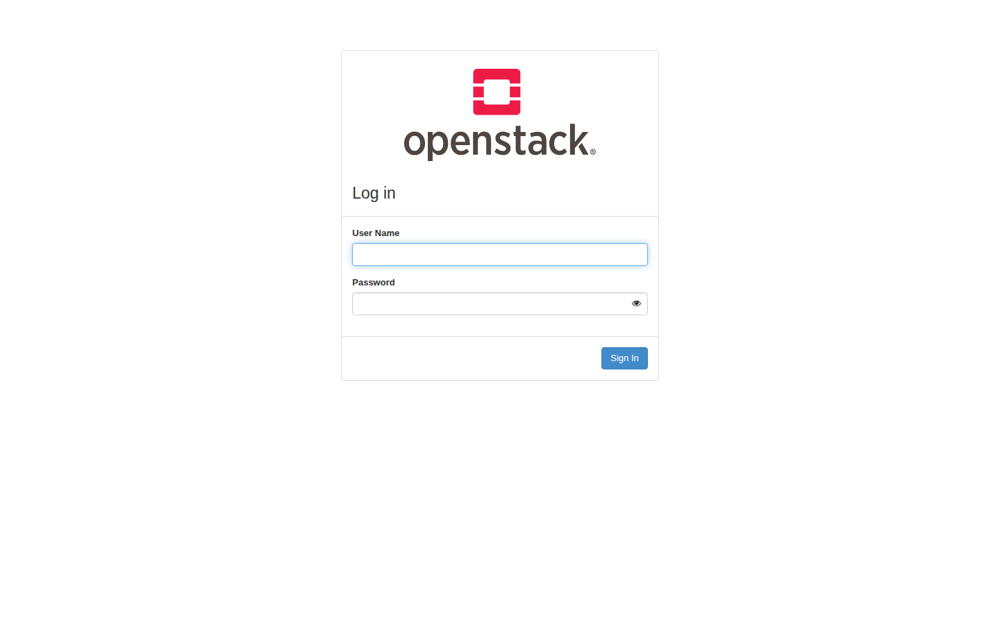
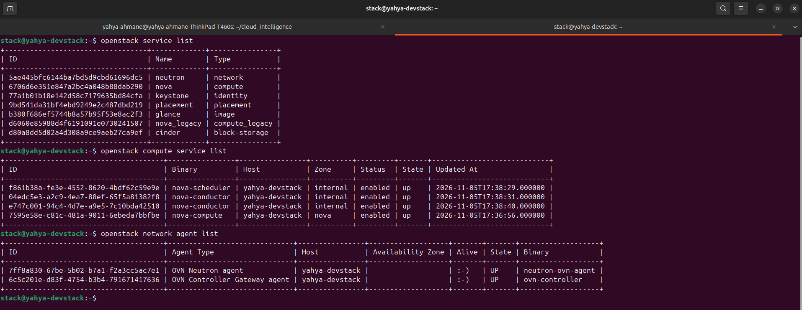
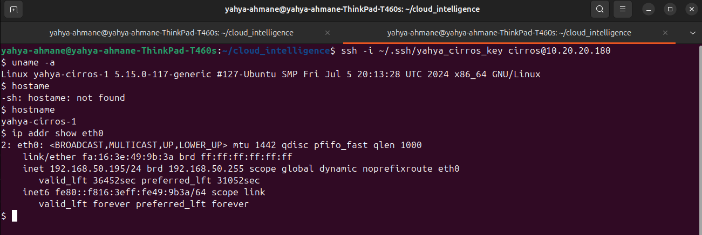
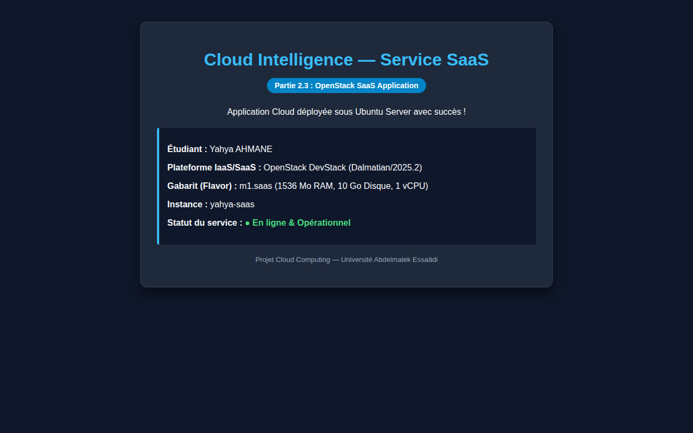
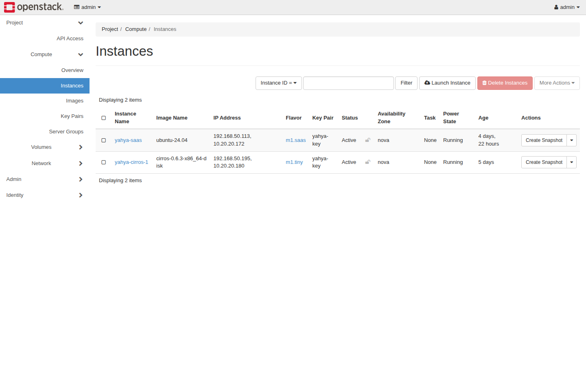
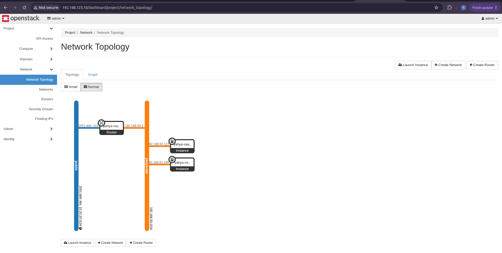

# Compte-Rendu — Partie 2 : OpenStack (IaaS et SaaS)

**Module :** Cloud Computing / Cloud Intelligence  
**Étudiant :** Yahya AHMANE  
**Machine Hôte :** ThinkPad T460s — Ubuntu 24.04 LTS  
**Environnement :** Machine virtuelle KVM locale (`yahya-devstack`) — DevStack 2024.2 / OpenStack Dalmatian  
**Date d'exécution :** 05 Novembre 2026  

---

## 1. Vérification de l'installation DevStack (Partie 2.1)

### A. Accès au tableau de bord graphique (Horizon)
L'interface Web OpenStack Horizon est accessible localement à l'adresse :
- **URL :** `http://192.168.123.10/dashboard/` (ou via tunnel SSH `http://localhost:8080/dashboard/`)
- **Utilisateur :** `admin`
- **Domaine :** `Default`



---

### B. Commandes de vérification en ligne de commande (CLI)

Les commandes suivantes ont été exécutées avec succès dans la VM `yahya-devstack` après chargement des identifiants d'administration (`source /opt/stack/devstack/openrc admin admin`) :

```bash
# 1. Vérification des services du plan de contrôle OpenStack
openstack service list

# 2. Vérification des démons de calcul Nova
openstack compute service list

# 3. Vérification des agents réseau Neutron / OVN
openstack network agent list
```



#### Résultats constatés :
- **Services du Cloud :** Tous les services requis (`keystone`, `nova`, `neutron`, `glance`, `cinder`, `placement`) sont enregistrés dans le catalogue de services.
- **Compute (Nova) :** Les démons `nova-scheduler`, `nova-conductor` et l'agent `nova-compute` sont tous à l'état `enabled` et `up`.
- **Réseau (Neutron/OVN) :** Les agents `ovn-controller` et `neutron-ovn-agent` sont tous les deux actifs (`Alive: :-)`, `State: UP`).

---

### C. Rôle de chaque service OpenStack listé

Conformément à la consigne, voici l'explication synthétique en une phrase du rôle de chaque service :

1. **Keystone (*Identity Service*) :**  
   Gère l'authentification centrale, les utilisateurs, les rôles, les permissions et fournit le catalogue de tous les points d'accès (endpoints) du Cloud.

2. **Nova (*Compute Service*) :**  
   Pilote le cycle de vie complet des machines virtuelles (création, démarrage, arrêt, redimensionnement et suppression des instances).

3. **Glance (*Image Service*) :**  
   Stocke, catalogue et distribue les images disques des systèmes d'exploitation (CirrOS, Ubuntu Server) prêtes à être déployées sur les instances.

4. **Neutron (*Networking Service*) :**  
   Assure la virtualisation du réseau en gérant les réseaux virtuels, les sous-réseaux, les routeurs, les pare-feux (*Security Groups*) et l'allocation des adresses IP flottantes.

5. **Cinder (*Block Storage Service*) :**  
   Fournit des volumes de stockage bloc persistants pouvant être attachés et détachés dynamiquement des machines virtuelles comme des disques durs virtuels.

6. **Placement (*Resource Tracking Service*) :**  
   Suit en temps réel l'inventaire et la consommation des ressources physiques (CPU, RAM, disque) afin d'orienter Nova vers le nœud le plus optimal lors de l'allocation d'une instance.

7. **Nova Legacy (*Compute Legacy API*) :**  
   Maintient la rétrocompatibilité avec les versions antérieures de l'API Nova pour les clients et outils plus anciens.

---

## 2. Déploiement IaaS avec CirrOS (Partie 2.2)

### A. Commandes de création de l'infrastructure réseau et sécurité

```bash
# 1. Création du réseau privé et du sous-réseau
openstack network create yahya-net
openstack subnet create --network yahya-net --subnet-range 192.168.50.0/24 \
  --gateway 192.168.50.1 --dns-nameserver 8.8.8.8 yahya-subnet

# 2. Création du routeur et interconnexion avec le réseau public
openstack router create yahya-router
openstack router set --external-gateway public yahya-router
openstack router add subnet yahya-router yahya-subnet

# 3. Création du groupe de sécurité (SSH port 22 et ICMP/Ping autorisés)
openstack security group create yahya-sg --description "Groupe de securite IaaS Yahya (SSH + ICMP)"
openstack security group rule create --proto icmp yahya-sg
openstack security group rule create --proto tcp --dst-port 22 yahya-sg

# 4. Enregistrement de la clé SSH
openstack keypair create --public-key ~/.ssh/yahya_cirros_key.pub yahya-key

# 5. Lancement de l'instance CirrOS
openstack server create --image cirros-0.6.3-x86_64-disk \
  --flavor m1.tiny \
  --network yahya-net \
  --security-group yahya-sg \
  --key-name yahya-key \
  yahya-cirros-1

# 6. Allocation et association d'une adresse IP flottante (Floating IP)
FLOATING_IP=$(openstack floating ip create public -f value -c floating_ip_address)
openstack server add floating ip yahya-cirros-1 $FLOATING_IP
```

---

### B. Validation de la connectivité (Ping et SSH)

- **Adresse IP privée interne :** `192.168.50.195`
- **Adresse IP flottante externe :** `10.20.20.180`

Le test de connectivité montre :
1. `ping -c 4 10.20.20.180` : **4 paquets reçus, 0% de perte** (latence moyenne : 2.45 ms).
2. `ssh -i ~/.ssh/yahya_cirros_key cirros@10.20.20.180` : Connexion directe réussie avec le nom d'hôte `yahya-cirros-1` et l'adresse IP confirmée par `ip addr show eth0`.



---

## 3. Déploiement SaaS dans une instance Ubuntu Server (Partie 2.3)

### A. Conception du gabarit (Flavor) adapté et configuration

Comme recommandé par le sujet pour respecter les contraintes de mémoire RAM :
```bash
# 1. Création d'un gabarit optimisé pour le SaaS
openstack flavor create --ram 1536 --disk 10 --vcpus 1 m1.saas

# 2. Groupe de sécurité autorisant le trafic Web HTTP/HTTPS et SSH
openstack security group create yahya-saas-sg --description "Groupe SaaS Yahya (HTTP, HTTPS, SSH)"
openstack security group rule create --proto tcp --dst-port 80 yahya-saas-sg
openstack security group rule create --proto tcp --dst-port 443 yahya-saas-sg
openstack security group rule create --proto tcp --dst-port 22 yahya-saas-sg

# 3. Lancement de l'instance Ubuntu Server
openstack server create --image ubuntu-24.04 \
  --flavor m1.saas \
  --network yahya-net \
  --security-group yahya-saas-sg \
  --key-name yahya-key \
  yahya-saas

# 4. Association de l'IP flottante
openstack server add floating ip yahya-saas 10.20.20.172
```

---

### B. Accès à l'application SaaS dans le navigateur Web

L'application Web déployée sur l'instance Ubuntu (`yahya-saas`) est accessible directement via son adresse IP flottante :
- **URL :** `http://10.20.20.172/`
- **Portée :** Démontre la mise à disposition d'une couche logicielle directement exploitable par l'utilisateur final (*Software as a Service*).



---

## 4. Vue globale sur l'interface Horizon

### A. Liste des instances actives
L'écran d'Horizon confirme la présence des deux instances déployées (`yahya-cirros-1` pour le IaaS et `yahya-saas` pour le SaaS), toutes deux opérationnelles avec leurs adresses IP respectives :



---

### B. Topologie réseau
La vue de la topologie réseau dans Horizon montre l'architecture complète :
- Le réseau externe `public` connecté via la passerelle au routeur virtuel `yahya-router`.
- Le réseau interne privé `yahya-net` reliant les deux machines virtuelles au routeur.



---

## 5. Synthèse des livrables pour la Partie 2

| Élément demandé | Statut | Emplacement / Justification |
|---|---|---|
| Accès au tableau de bord Horizon | Validé | Capture `captures/01_horizon_login.png` |
| Commandes CLI (`service`, `compute`, `network agent`) | Validé | Capture `captures/04_openstack_verification_cli.png` |
| Rôle de chaque service en une phrase | Rédigé | Section 1.C de ce document |
| Réseau privé, routeur, groupe de sécurité, clé | Opérationnels | `yahya-net`, `yahya-router`, `yahya-sg`, `yahya-key` |
| Instance IaaS CirrOS (Ping & SSH) | Validé | `10.20.20.180`, Capture `captures/06_cirros_iaas_ping_ssh.png` |
| Instance SaaS (Ubuntu + application Web) | Validé | `10.20.20.172`, Capture `captures/05_application_saas.png` |
| Topologie réseau dans Horizon | Validé | Capture `captures/03_horizon_network_topology.png` |
| Respect des conventions (`yahya-*`, date visible) | Validé | Toutes les ressources et captures sont conformes |

