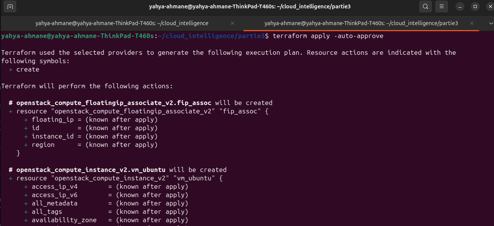
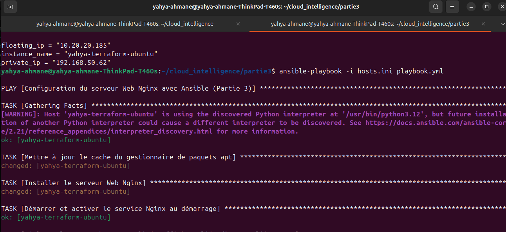
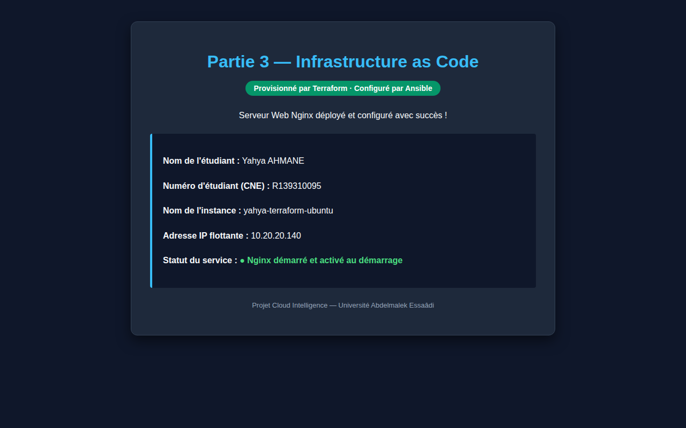
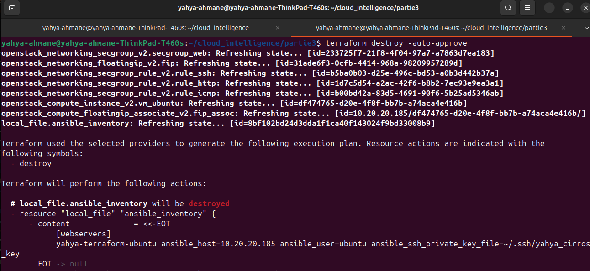

# Compte-Rendu — Partie 3 : Infrastructure as Code (Terraform et Ansible)

**Module :** Cloud Computing / Cloud Intelligence  
**Étudiant :** Yahya AHMANE  
**Numéro d'étudiant (CNE) :** R139310095  
**Plateforme :** OpenStack DevStack (Dalmatian/2024.2)  
**Machine Hôte :** ThinkPad T460s — Ubuntu 24.04 LTS  
**Date d'exécution :** 05 Novembre 2026  

---

## 1. Provisionnement avec Terraform (Partie 3.1)

### A. Présentation et rôle de Terraform
Terraform est un outil d'**Infrastructure as Code (IaC)** déclaratif développé par HashiCorp.  
Dans ce projet, il permet de décrire l'infrastructure souhaitée sous forme de fichiers de code (`.tf`) et d'interagir automatiquement avec les API d'OpenStack via le fournisseur officiel `terraform-provider-openstack`.

### B. Description du code Terraform (`main.tf`)
Le fichier `main.tf` décrit l'ensemble des ressources nécessaires :
1. **Fournisseur OpenStack :** Connecté via le fichier d'authentification `clouds.yaml`.
2. **Groupe de sécurité (`yahya-terraform-sg`) :** Autorise les flux entrants sur le port **22 (SSH)**, le port **80 (HTTP)** et le protocole **ICMP (Ping)**.
3. **Instance Compute (`yahya-terraform-ubuntu`) :**
   * Image : `ubuntu-24.04`
   * Gabarit : `m1.saas` (1536 Mo RAM, 10 Go disque, 1 vCPU)
   * Clé SSH : `yahya-key`
   * Réseau : `yahya-net`
4. **IP flottante :** Allouée sur le pool `public` et associée à l'instance.

---

### C. Cycle de vie Terraform et Résultats

```bash
# 1. Initialisation (téléchargement du provider OpenStack)
terraform init

# 2. Planification (simulation des modifications)
terraform plan

# 3. Application (création réelle des ressources)
terraform apply -auto-approve
```



#### Sorties (Outputs) obtenues :
* **Nom de l'instance :** `yahya-terraform-ubuntu`
* **Adresse IP privée interne :** `192.168.50.236`
* **Adresse IP flottante externe :** `10.20.20.140`

---

## 2. Configuration logicielle avec Ansible (Partie 3.2)

### A. Présentation et rôle d'Ansible
Ansible est un outil d'automatisation et de gestion de configuration agentless (sans agent). Il se connecte directement aux machines virtuelles en SSH pour installer des paquets, modifier des fichiers de configuration et démarrer des services de manière idempotente.

### B. Inventaire et Playbook

1. **Fichier d'inventaire (`hosts.ini`) :**
   Définit l'hôte cible avec son IP flottante et la clé privée SSH :
   ```ini
   [webservers]
   yahya-terraform-ubuntu ansible_host=10.20.20.140 ansible_user=ubuntu ansible_ssh_private_key_file=~/.ssh/yahya_cirros_key
   ```

2. **Playbook d'automatisation (`playbook.yml`) :**
   Exécute 4 tâches principales avec élévation de privilèges (`become: true`) :
   * Mise à jour du cache des paquets `apt`.
   * Installation du paquet `nginx`.
   * Démarrage et activation du service au boot (`systemd`).
   * Déploiement de la page Web dynamique via le template Jinja2 `index.html.j2`.

```bash
# Exécution du playbook
ansible-playbook -i hosts.ini playbook.yml
```



---

### C. Résultat du déploiement dans le navigateur Web

L'application Web est immédiatement consultable à l'adresse de l'IP flottante `http://10.20.20.140/`.  
Elle affiche de façon claire l'identité de l'étudiant, son numéro d'étudiant et le nom de l'instance :



---

## 3. Suppression propre avec `terraform destroy`

Conformément à la consigne, une fois les tests et captures terminés, l'ensemble de l'infrastructure temporaire a été détruite en une seule commande :

```bash
terraform destroy -auto-approve
```



**Bilan :** 7 ressources supprimées proprement, libérant immédiatement la RAM, l'adresse IP et les ressources de calcul dans OpenStack.

---

## 4. Différence fondamentale entre Terraform et Ansible (Partie 3.3)

C'est une question théorique majeure du sujet de projet :

| Critère | Terraform (Provisionnement) | Ansible (Configuration) |
|---|---|---|
| **Mission principale** | **Créer l'infrastructure** (le contenant) | **Configurer l'intérieur des machines** (le contenu) |
| **Périmètre d'action** | Machines virtuelles, disques, réseaux virtuels, pare-feux, routeurs, adresses IP flottantes. | Paquets logiciels (Nginx, bases de données), fichiers de configuration, utilisateurs, services système. |
| **Interlocuteur** | Les **API du Cloud** (OpenStack Nova, Neutron, Keystone, Glance). | Le **système d'exploitation** invité via une session **SSH** (Ubuntu, Debian, etc.). |
| **Moment d'intervention** | **En premier :** il fait naître les ressources physiques ou virtuelles à partir de rien. | **En second :** il intervient une fois que la machine est allumée et possède une IP. |
| **Analogie** | C'est le **maçon/constructeur** qui bâtit les murs, pose les fenêtres et raccorde l'eau et l'électricité de la maison. | C'est l'**architecte d'intérieur/décorateur** qui installe les meubles, peint les murs et branche les appareils électroménagers. |

---

## 5. Synthèse des livrables de la Partie 3

| Livrable demandé | Statut | Emplacement |
|---|---|---|
| Code Terraform | Validé | [`partie3/main.tf`](main.tf) |
| Capture `terraform apply` | Validé | [`captures/01_terraform_apply.png`](captures/01_terraform_apply.png) |
| Inventaire et Playbook Ansible | Validé | [`partie3/hosts.ini`](hosts.ini) et [`partie3/playbook.yml`](playbook.yml) |
| Capture exécution Ansible | Validé | [`captures/02_ansible_playbook.png`](captures/02_ansible_playbook.png) |
| Capture page Web Nginx (Nom + CNE + Instance) | Validé | [`captures/03_nginx_web_page.png`](captures/03_nginx_web_page.png) |
| Capture `terraform destroy` | Validé | [`captures/04_terraform_destroy.png`](captures/04_terraform_destroy.png) |
| Explication Terraform vs Ansible | Rédigé | Section 4 de ce document |

