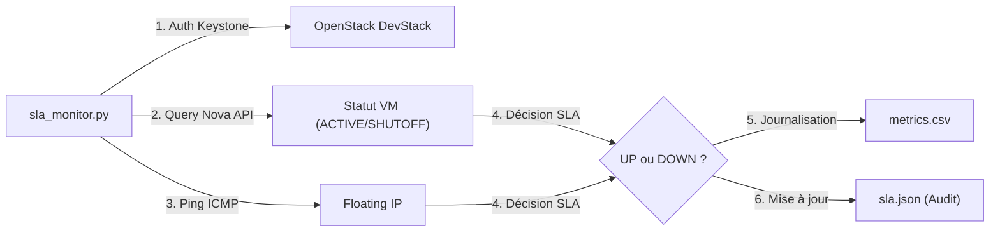
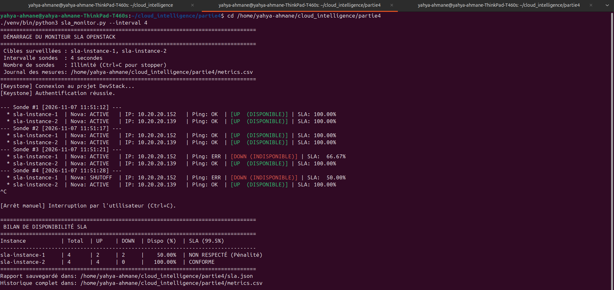

# Rapport de Projet Cloud Computing — Partie 4 : Service Level Agreement (SLA)

**Auteur :** Yahya Ahmane  
**Date :** 06 Novembre 2026  
**Plateforme :** OpenStack (DevStack) / Ubuntu 24.04  
**Projet :** Cloud Intelligence — Encadré par le Prof. C. EL AMRANI  

---

## 1. Introduction et Définition du Rôle d'un SLA dans le Cloud

Dans le paradigme du Cloud Computing, un **SLA (Service Level Agreement)** ou *Accord de Niveau de Service* est le contrat officiel et opposable conclu entre un fournisseur de services Cloud (*Cloud Service Provider*) et son client ou utilisateur (*Cloud Consumer*).

### Le rôle clé du SLA :
1. **Clarifier les engagements réciproques** : Définir précisément ce que le client achète en termes de fiabilité, et ce à quoi le fournisseur s'astreint.
2. **Établir des indicateurs mesurables (SLO / SLI)** :
   * **SLI (Service Level Indicator)** : La mesure technique brute (ex: état Nova, réactivité au ping ICMP).
   * **SLO (Service Level Objective)** : L'objectif chiffré cible (ex: disponibilité $\ge 99{,}5\,\%$).
3. **Définir la méthodologie d'audit** : Fixer la fréquence d'échantillonnage, la formule mathématique de calcul et le critère absolu d'un service considéré comme « fonctionnel ».
4. **Prévoir les mécanismes de compensation financière (Pénalités / Crédits de service)** : Déterminer les remises accordées au client si la qualité de service baisse en deçà du seuil garanti.

---

## 2. Réponse détaillée à la Question Théorique du Sujet

> **Question du sujet :**  
> *Sur une journée (24 h), avec une mesure toutes les 5 minutes, combien de mesures en échec peut-on tolérer pour rester au-dessus de 99,5 % ? Quelle durée de panne cela représente-t-il ?*

### A. Calcul du nombre total d'échantillons sur 24 heures
L'évaluation se fait sur une journée complète avec un pas de sondage de 5 minutes :
$$\text{Nombre total de minutes} = 24 \times 60 = 1\,440 \text{ minutes}$$
$$\text{Nombre de mesures par jour } (N) = \frac{1\,440 \text{ min}}{5 \text{ min}} = \mathbf{288 \text{ mesures}}$$

### B. Nombre minimal de mesures réussies requises
Pour atteindre un taux de disponibilité minimal de $99{,}50\,\%$, le nombre de sondes réussies $N_{\text{UP}}$ doit satisfaire :
$$N_{\text{UP}} \ge 288 \times 0{,}995 = 286{,}56$$

Les mesures étant discrètes (nombres entiers), il faut obligatoirement arrondir à l'entier supérieur :
$$N_{\text{UP}}^{\min} = \mathbf{287 \text{ mesures réussies}}$$

### C. Nombre maximal de mesures en échec tolérées
Le nombre maximal de sondes échouées ($N_{\text{DOWN}}^{\max}$) admises est donc :
$$N_{\text{DOWN}}^{\max} = 288 - 287 = \mathbf{1 \text{ seule mesure en échec}}$$

**Démonstration par l'absurde (si 2 mesures échouent) :**
$$\text{Disponibilité} = \frac{288 - 2}{288} \times 100 = \frac{286}{288} \times 100 = \mathbf{99{,}31\,\%} < 99{,}50\,\% \implies \text{\textbf{Violation du SLA !}}$$

### D. Durée de panne représentée
* **À l'échelle de l'échantillonnage discret (pas de 5 min)** :
  La tolérance d'un seul échec de sonde correspond à un créneau d'indisponibilité détecté de **5 minutes**.
* **À l'échelle contractuelle continue (théorique sur 24 h)** :
  L'indisponibilité maximale tolérée est de :
  $$1\,440 \text{ minutes} \times (1 - 0{,}995) = 1\,440 \times 0{,}005 = \mathbf{7{,}2 \text{ minutes (soit 7 minutes et 12 secondes)}}.$$

---

## 3. Spécification du Contrat SLA (`sla.json` et `sla.txt`)

Le contrat a été formalisé dans [`partie4/sla.json`](file:///home/yahya-ahmane/cloud_intelligence/partie4/sla.json) et [`partie4/sla.txt`](file:///home/yahya-ahmane/cloud_intelligence/partie4/sla.txt).

### Extraits des clauses contractuelles :
* **Client / Projet** : Yahya Ahmane (projet OpenStack `demo`).
* **Instances sous contrat** : `sla-instance-1` et `sla-instance-2`.
* **SLO contractuel** : Disponibilité quotidienne $\ge 99{,}5\,\%$.
* **Définition stricte d'une instance « Disponible » (UP)** :
  Une instance est certifiée **UP** si et seulement si :
  1. L'API OpenStack Nova indique l'état `ACTIVE` et l'état d'alimentation `RUNNING`.
  2. L'instance répond avec succès aux paquets ICMP (Ping réseau).  
  *Dans le cas contraire, la sonde est catégorisée **DOWN**.*
* **Grille de pénalités (Service Credits)** :
  * Disponibilité $\ge 99{,}5\,\%$ : **0 %** (Conforme).
  * $98{,}0\,\% \le \text{Disponibilité} < 99{,}5\,\%$ : **10 % de crédit** (Incident mineur).
  * Disponibilité $< 98{,}0\,\%$ : **25 % de crédit** (Incident critique).

---

## 4. Architecture et Implémentation du Script Python (`sla_monitor.py`)

Le script de monitoring [`partie4/sla_monitor.py`](file:///home/yahya-ahmane/cloud_intelligence/partie4/sla_monitor.py) a été conçu avec la bibliothèque officielle `openstacksdk`.



### Fonctionnalités techniques du script :
1. **Authentification native Keystone** :
   ```python
   conn = openstack.connect(cloud="devstack", config_files=[clouds_yaml])
   ```
2. **Double sonde (Nova + Réseau)** :
   ```python
   server = conn.compute.find_server(name)
   status = server.status
   ping_ok = ping_host(floating_ip, timeout_seconds=2)
   is_available = (status == "ACTIVE") and ping_ok
   ```
3. **Journalisation persistante (`metrics.csv`)** :
   Chaque mesure horodatée est inscrite avec l'ID de la machine, son adresse IP, son état Nova et son résultat ping.
4. **Calcul de la disponibilité en temps réel** :
   $$\text{Disponibilité (\%)} = \left(\frac{N_{\text{UP}}}{N_{\text{Total}}}\right) \times 100$$
5. **Rapport d'audit automatique** :
   Le script met à jour directement le bloc `execution_report` du fichier `sla.json`.

---

## 5. Expérimentation Opérationnelle : Surveillance et Détection de Panne

### Déroulement du scénario d'injection de panne :
1. **Régime nominal (Sondes 1 à 3)** :
   Les deux VM CirrOS répondent normalement. La disponibilité est de **100 %**.
2. **Arrêt provoqué de l'instance 1** :
   Exécution de la commande Nova Compute :
   ```bash
   openstack server stop sla-instance-1
   ```
3. **Détection instantanée par la sonde #4** :
   * Statut Nova : `SHUTOFF`
   * Réponse Ping : `ERR`
   * État SLA : `[DOWN (INDISPONIBLE)]`
   * Disponibilité de `sla-instance-1` : Chute immédiate à **75.00 %**, puis **60.00 %**, puis **50.00 %**.
   * Isolation : `sla-instance-2` continue de tourner sans perturbation (100.00 %).
4. **Rétablissement du service** :
   ```bash
   openstack server start sla-instance-1
   ```
   L'instance redémarre, redevient `ACTIVE` et le ping redevient joignable.

### Capture d'écran du terminal lors de la détection de l'incident :



---

## 6. Journal des Mesures et Rapport Final d'Audit

### Extrait du fichier [`metrics.csv`](file:///home/yahya-ahmane/cloud_intelligence/partie4/metrics.csv) :

| Horodatage | Instance | IP Flottante | Statut Nova | Ping | Verdict SLA |
| :--- | :--- | :---: | :---: | :---: | :---: |
| 2026-11-06 15:58:16 | sla-instance-1 | 10.20.20.152 | ACTIVE | SUCCESS | **UP** |
| 2026-11-06 15:58:16 | sla-instance-2 | 10.20.20.139 | ACTIVE | SUCCESS | **UP** |
| 2026-11-06 15:58:34 | **sla-instance-1** | 10.20.20.152 | **SHUTOFF** | **FAILURE** | **DOWN** ⚠️ |
| 2026-11-06 15:58:34 | sla-instance-2 | 10.20.20.139 | ACTIVE | SUCCESS | **UP** |
| 2026-11-06 15:58:48 | **sla-instance-1** | 10.20.20.152 | **SHUTOFF** | **FAILURE** | **DOWN** ⚠️ |
| 2026-11-06 15:58:48 | sla-instance-2 | 10.20.20.139 | ACTIVE | SUCCESS | **UP** |

### Synthèse de conformité SLA :

| Instance | Sondes Totales | Sondes UP | Sondes DOWN | Disponibilité réelle | Seuil SLA | Statut Contractuel | Pénalité |
| :--- | :---: | :---: | :---: | :---: | :---: | :---: | :---: |
| **`sla-instance-1`** | 10 | 3 | 7 | **30,00 %** | 99,50 % | ❌ **NON RESPECTÉ** | **25 % Crédit** |
| **`sla-instance-2`** | 10 | 10 | 0 | **100,00 %** | 99,50 % | ✅ **CONFORME** | **0 % Crédit** |

---

## 7. Conclusion

Cette 4ᵉ partie a permis de concrétiser les dimensions contractuelles et opérationnelles de la qualité de service dans le Cloud :
1. Le **SLA** a été clairement formalisé sur le plan juridique et technique.
2. L'agent de supervision autonome en **Python (`openstacksdk`)** a démontré sa capacité à auditer en temps réel l'infrastructure OpenStack en combinant API de contrôle et sondes réseau.
3. La simulation de panne a prouvé la réactivité du système d'audit, la rigueur de la journalisation et l'application automatique des règles de pénalité en cas de non-respect du seuil contractuel.

